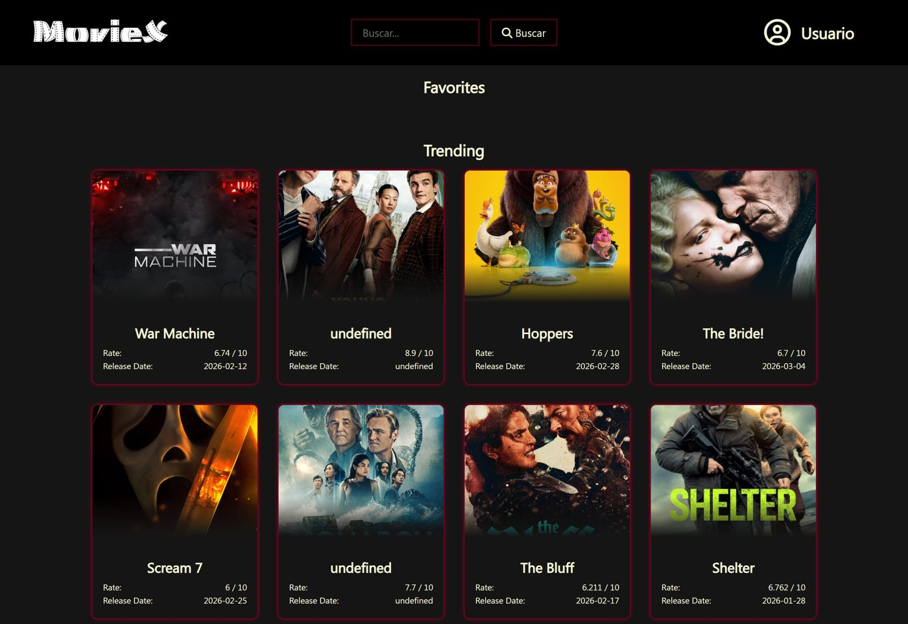

# 🎬 MovieX

Buscador de películas que te dice **en qué plataforma de streaming puedes ver cada una**, junto con su ficha y su tráiler.

**[▶ Ver demo](https://andreuet23.github.io/MovieX/)**



## Funcionalidades

- 🔥 **Tendencias de la semana** al entrar.
- 🔎 **Búsqueda** de cualquier película por título.
- 🎞️ **Ficha detallada**: sinopsis, valoración y datos principales.
- ▶️ **Tráiler** integrado desde YouTube.
- 📺 **Dónde verla**: plataformas de streaming disponibles (Netflix, Prime Video, HBO…).
- ⭐ **Favoritos** guardados en el navegador (localStorage).

## Tecnologías

- HTML5, CSS3 y JavaScript sin frameworks
- Peticiones asíncronas (`fetch` + `async/await`) a la API REST de [TMDB](https://www.themoviedb.org/)
- **Cloudflare Workers** como proxy de la API
- Publicado con GitHub Pages

## Arquitectura y seguridad

```
navegador (GitHub Pages) ──► Cloudflare Worker (guarda la clave) ──► API de TMDB
```

La clave de la API **no está en el código ni llega al navegador**: la web llama a un Worker de Cloudflare ([`worker/worker.js`](worker/worker.js)), que añade la clave desde un *secret* y reenvía la petición a TMDB. Además, el Worker:

- solo responde a la web de MovieX (comprobación del `Origin` y CORS);
- solo permite las 5 consultas que usa la app (lista blanca de rutas);
- solo reenvía los parámetros necesarios, con longitud limitada;
- no muestra detalles internos en los errores.

## Cómo ejecutarlo en local

1. Clona el repositorio:
   ```bash
   git clone https://github.com/Andreuet23/MovieX.git
   cd MovieX
   ```
2. Abre `index.html` con la extensión *Live Server* de VS Code. El Worker acepta peticiones desde `localhost` y `127.0.0.1`.

Si quieres desplegar tu propia versión, crea un Worker con el código de `worker/worker.js`, guarda tu clave de TMDB como secret `TMDB_API_KEY` y pon la URL del Worker en `API_URL`, en `js/app.js`.

## Créditos

Este producto utiliza la API de TMDB, pero no está respaldado ni certificado por TMDB. Los datos de plataformas de streaming los proporciona [JustWatch](https://www.justwatch.com/) a través de TMDB.

---

Hecho por [Andreu Simonet](https://www.linkedin.com/in/andreusimonet).
